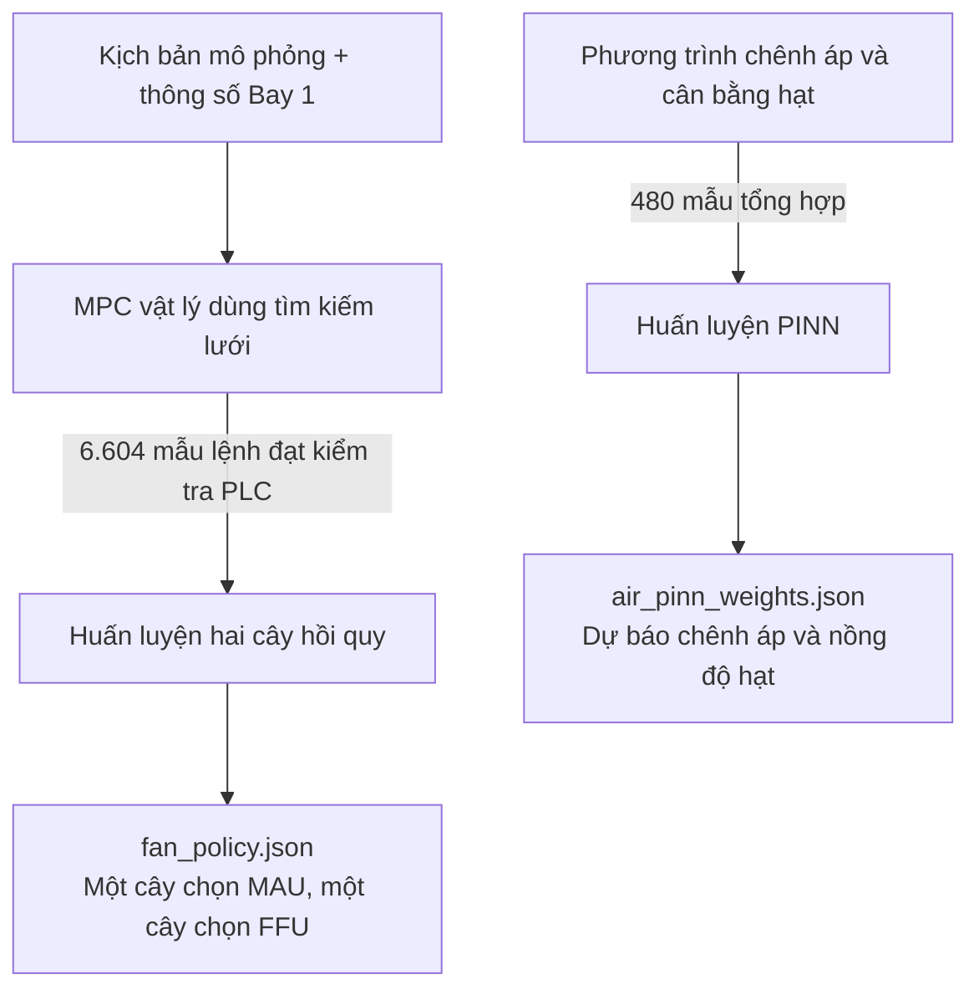

# AI chọn tốc độ MAU/FFU và chốt PLC mô phỏng

Hai cây hồi quy chọn tốc độ quạt, PINN dự báo trạng thái phòng và PLC quyết định lệnh thực thi. [Sơ đồ điều khiển vòng kín](../README.md#luồng-ai-điều-khiển-mau-và-ffu).

## 1. Huấn luyện ngoại tuyến



MPC xếp các phương án theo điện quạt dự kiến và ưu tiên phương án đầu tiên đáp ứng ràng buộc. Mỗi cây học mức điều chỉnh trong dải tốc độ có thể thực hiện từ các lệnh MPC đã qua chốt. Tìm kiếm lưới chạy trong khâu tạo mẫu và trong nhánh đối chứng MPC. [Mã MPC](../bay1_control.py) · [Cơ sở phương pháp học luật điều khiển](https://arxiv.org/abs/1806.10644).

## 2. Điều khiển mỗi 60 giây

1. **Đọc cảm biến và MES.** Các đầu vào chính gồm chênh áp, nồng độ hạt ≥0,1 µm và ≥0,5 µm, nhiệt độ, độ ẩm, NH₃, lưu lượng xả, trạng thái cửa, tải sản xuất, lịch tải và xả năm bước tiếp theo cùng tốc độ đã thực thi ở chu kỳ trước.
2. **Hai cây hồi quy đề xuất tốc độ.** Mỗi cây suy luận một lần trong chu kỳ đủ điều kiện. Bộ điều khiển quy đổi kết quả thành một cặp tốc độ theo dải cho phép. Cận dưới MAU tính đến lượng khí cấp bù, lịch tăng xả đã biết và giới hạn thay đổi tốc độ. [Mã AI](../bay1_policy.py).
3. **PINN dự báo hệ quả của lệnh.** Mạng dự báo chênh áp và nồng độ hạt sau một phút ứng với cặp tốc độ đề xuất. Nếu dự báo vượt giới hạn ngoài biên sai số kiểm định, cảnh báo được chuyển đến PLC.
4. **PLC quyết định lệnh thực thi.** PLC kiểm tra thời điểm của mẫu và lệnh, dữ liệu cảm biến, phạm vi tốc độ, giới hạn thay đổi tốc độ và dự báo vật lý một bước cho lệnh đủ điều kiện. Khi có lỗi, mất kết nối hoặc lệnh bị chặn, PLC chạy tốc độ dự phòng và yêu cầu tạm dừng sản xuất. Sau sự cố, PLC cần ba mẫu mới liên tiếp qua kiểm tra để gỡ yêu cầu tạm dừng. [Chốt PLC](../bay1_control.py).
5. **Bay 1 phản hồi.** Mô phỏng áp dụng tốc độ thực thi vào MAU và FFU, ghi công suất quạt và cập nhật trạng thái phòng cho lần đo tiếp theo. [Vòng lặp mô phỏng](../bay1_simulation.py).

Ở chu kỳ thứ 26 của benchmark, AI đề xuất **MAU 70,0%** và **FFU 61,5%**. PLC duyệt cặp tốc độ này, đưa tổng công suất quạt trong chu kỳ xuống **9,29 kW**, so với **19,72 kW** ở chế độ quạt cố định. Điện quạt 24 giờ được tính bằng cách nhân công suất quạt với thời lượng mỗi chu kỳ rồi cộng lại. [Dữ liệu từng chu kỳ](../bay1_traces.js).

## PINN dự báo chênh áp và hạt

PINN dùng hai lớp ẩn tanh để học đáp ứng bậc nhất theo thời gian đã chuẩn hóa. Mô hình nhận cặp tốc độ do cây hồi quy đề xuất rồi tính ΔP và hai kênh hạt sau một bước 60 giây. Cân bằng gió cho giá trị chênh áp ổn định. Cân bằng nguồn hạt và lưu lượng loại bỏ cho nồng độ cân bằng.

Với mỗi đại lượng `x`, mạng dùng quan hệ `x(t) = x₀ + (x_cân_bằng − x₀) × y(t/τ)`. Điều kiện đầu `y(0) = 0` được nhúng vào cấu trúc mạng. Hàm mất mát gồm chênh lệch so với dữ liệu tổng hợp và phần dư phương trình `dy/ds + y − 1 = 0`, với `s = t/τ`.

PINN gửi cảnh báo nếu dự báo vượt ngưỡng ngoài biên sai số thử mô phỏng. Biên này tính từ sai số trên lưới kiểm định, dùng để giảm việc chặn nhầm do xấp xỉ gần ngưỡng. PLC dự báo vật lý để duyệt mọi lệnh còn đủ điều kiện, kể cả khi checkpoint PINN thiếu hoặc chu kỳ nằm ngoài miền của mạng. [Mã PINN](../bay1_air_pinn.py) · [Checkpoint và chỉ số kiểm định](air_pinn_weights.json).

## Chạy và huấn luyện

```powershell
python 02_ai_solution/run_ai_solution.py
python 02_ai_solution/run_interactive_ai_solution.py
python compare_benchmarks.py
```

Mở [dashboard](../cleanroom_visualizer.html) để xem lệnh AI đề xuất, dự báo PINN và tốc độ quạt thực thi. [Checkpoint](fan_policy.json) được kèm theo và chạy bằng NumPy. Khi huấn luyện lại, trình huấn luyện cần scikit-learn.

```powershell
python 02_ai_solution/train_fan_policy.py
python 02_ai_solution/train_air_pinn.py
```

Dữ liệu huấn luyện gồm ba kịch bản mô phỏng với các seed riêng và các trạng thái tổng hợp gần giới hạn. Cây học từ các lệnh đạt chốt do MPC vật lý tạo. Checkpoint lưu **6.604 mẫu huấn luyện** và chỉ số sai số trên **4.958 mẫu kiểm định tách riêng**. Kết quả mô phỏng vòng kín và các bài kiểm thử PLC được đánh giá riêng với sai số học bắt chước.

Huấn luyện PINN cần SciPy. Checkpoint kèm dự án dùng **480 mẫu tổng hợp** từ cùng phương trình đang dùng trong mô hình Bay 1. Nghiệm vật lý đã có dạng giải tích, do đó bộ thử này phù hợp để kiểm tra tích hợp mạng và đo sai số xấp xỉ.

## Đọc kết quả

Benchmark ghi điện quạt, phút ngoài giới hạn, số lệnh AI đề xuất và số lệnh bị chặn. Thời gian tính lệnh trung vị được đo riêng trên các chu kỳ có trạng thái `SAFE`, gồm tính lệnh và kiểm tra PLC trong cùng tiến trình Python. Lịch MES, mô hình phòng, nhiễu và giới hạn được dùng chung trong phép đối chứng. Kết quả phản ánh điều khiển trong mô phỏng Bay 1. [Benchmark đối chứng](../benchmark_comparison.json) · [Năm kịch bản](../03_scenario_testing/scenarios_benchmark_results.json).

Phép thử `pinn_comparison` tắt riêng PINN, giữ cùng cây hồi quy và PLC. Bật PINN cho **7.898 lượt dự báo** trên benchmark và năm kịch bản chuẩn, với **0 lệnh bị PINN cảnh báo**, **0 lệnh thực thi thay đổi** và **0 kWh tiết kiệm thêm**. Bài kiểm thử riêng với nguồn hạt tổng hợp cao xác nhận PINN cảnh báo lệnh và PLC chuyển sang chế độ dự phòng. Đóng góp trên dữ liệu cảm biến fab cần được đánh giá riêng.
