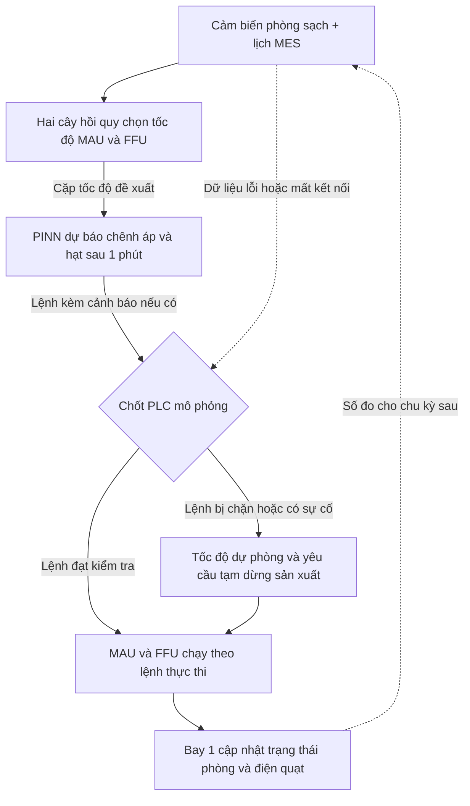

# Bay 1 300 mm — điều khiển thông gió theo nhu cầu

Mô phỏng một vùng Lithography & Track với MAU cấp khí tươi, 48 FFU tuần hoàn, xả công nghệ và một cửa nối hành lang. Tải MES và sự cố là các kịch bản tổng hợp. [bay1_config.json](bay1_config.json) là cấu hình dùng chung cho Python, báo cáo và dashboard.

## Luồng AI điều khiển MAU và FFU

**Khi huấn luyện**, MPC vật lý dùng tìm kiếm lưới để tạo mẫu lệnh MAU/FFU tiết kiệm điện trong các kịch bản Bay 1. Hai cây hồi quy học từ các mẫu này, mỗi cây phụ trách một tốc độ. PINN được huấn luyện riêng để dự báo chênh áp và nồng độ hạt. [Sơ đồ huấn luyện và chi tiết một chu kỳ](02_ai_solution/README.md).

**Khi mô phỏng**, hai cây hồi quy trực tiếp đề xuất cặp tốc độ mỗi phút nếu đủ điều kiện. PLC mô phỏng quyết định tốc độ thực thi.



AI tác động đến điện năng ở bước **chọn cặp tốc độ MAU/FFU**. Khi trạng thái phòng và lịch xả cho phép giảm tốc độ, lệnh được PLC duyệt làm giảm công suất quạt. PINN dùng cặp tốc độ đã đề xuất để dự báo rủi ro trước chốt.

## Chạy mô phỏng

Cần Python và NumPy cho tính toán. Matplotlib dùng cho biểu đồ và giao diện desktop. Pytest dùng cho kiểm tra hồi quy.

```powershell
python compare_benchmarks.py
python 03_scenario_testing/scenario_runner.py
python 03_scenario_testing/visualize_scenarios.py
python -m pytest -q
```

Chạy `python 02_ai_solution/run_interactive_ai_solution.py` để theo dõi tốc độ thực thi, điện quạt và trạng thái PLC trong mô phỏng tương tác.

Mở [cleanroom_visualizer.html](cleanroom_visualizer.html) để xem luồng mô phỏng 24 giờ từ `bay1_traces.js`. Trang hoạt động trực tiếp từ thư mục dự án. `python compare_benchmarks.py --no-plots` cập nhật JSON và dữ liệu web khi chỉ cài NumPy.

Các điểm chạy desktop gồm `run_interactive_comparison.py`, `run_interactive_scenarios.py` và `run_live_environmental_tuning.py`. Hai thư mục `01_baseline` và `02_ai_solution` vẫn có điểm chạy riêng cho từng nhánh.

## Cách điều khiển và đọc KPI

- **Fixed speed** giữ MAU 95% và FFU 100% theo cấu hình đối chuẩn.
- **Pressure reference** điều tiết MAU theo lưu lượng xả và mục tiêu áp suất, giữ FFU ở 100%. Chế độ này cung cấp mốc đối chứng cho phần tối ưu FFU.
- **Điện quạt** là tổng MAU và FFU theo thời gian. **Điện HVAC ước tính** dùng thêm tải lạnh chia cho COP giả định 3,5 và tái gia nhiệt điện. Báo cáo ghi năng lượng tái gia nhiệt riêng theo kWh nhiệt.

Trong benchmark 24 giờ, luồng hai cây hồi quy + PINN + PLC dùng **278,09 kWh điện quạt**, giảm **41,23%** từ mức **473,20 kWh** của chế độ quạt cố định. MPC vật lý và hai cây hồi quy + PLC cũng cho **278,09 kWh**. Cả ba có **20 phút** vượt ít nhất một giới hạn môi trường mô phỏng. Bật PINN cho **0 chu kỳ đổi lệnh** trong benchmark và năm kịch bản chuẩn. [Benchmark 24 giờ](benchmark_comparison.json) · [Năm kịch bản](03_scenario_testing/scenarios_benchmark_results.json)

[Đặc tả Bay 1](SEMICONDUCTOR_FAB_SPECIFICATIONS.md) ghi các giả định mô hình, nguồn và phần cần đo tại hiện trường. [Báo cáo rà soát](HVAC_SYSTEM_AUDIT.md) là mốc trước khi sửa.
